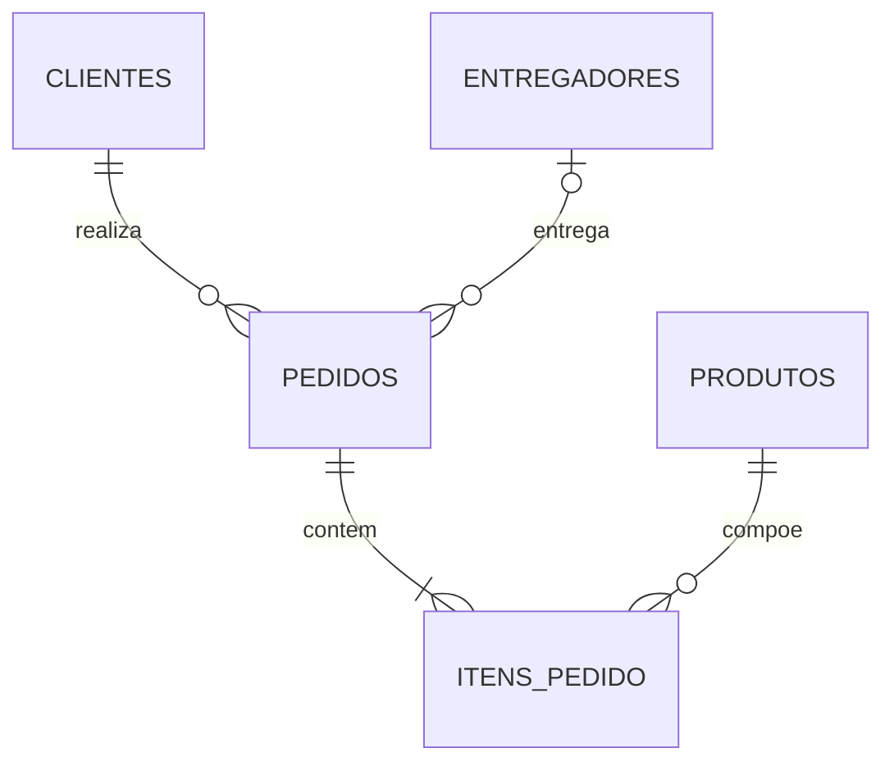

As migrations MySQL ficam ordenadas pelo prefixo numérico. `001-inicial.sql` cria as seis tabelas base; aplique-a uma vez no banco da equipe antes de executar o seed.

Chaves estrangeiras:

- `pedidos.cliente_id` referencia `clientes.id`.
- `pedidos.entregador_id` referencia `entregadores.id` e aceita `NULL` enquanto não houver entregador atribuído.
- `itens_pedido.pedido_id` referencia `pedidos.id`; os itens são removidos junto com o pedido.
- `itens_pedido.produto_id` referencia `produtos.id`.

`usuarios` e `clientes` são os únicos módulos com repositórios e APIs nesta fase. As tabelas `produtos`, `entregadores`, `pedidos` e `itens_pedido` preparam o schema para as fases seguintes, sem handlers públicos nesta entrega.
